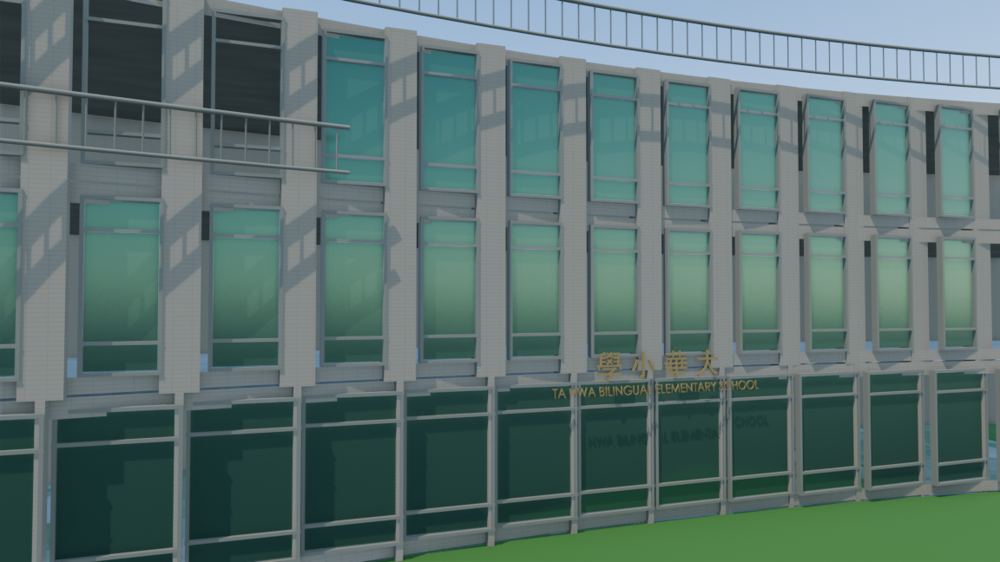
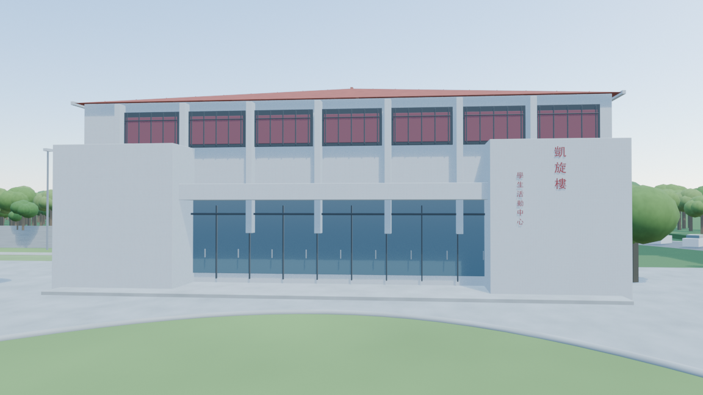

# 大華中學校園 3D 模型與動畫

## 最新版本：v5 校舍、人物與校歌字幕

[模型與來源](v5/README.md)：修補 1:12、1:22 附近的立面問題，新增粗體立體招牌與 47 名匿名學生行走；維持日景，已完成 94 秒、2560×1440、24 fps。含大華中學封面、使用者提供的原速校歌與分句繁體歌詞。

- [校歌字幕版影片](v5/dahua-campus-94s-v5-school-song.mp4)
- [可編輯 Blender 模型](v5/dahua-campus-v5.blend)
- [封面](v5/music/大華中學_封面.jpg)
- [歌詞字幕 SRT](v5/music/lyrics.srt)
- [影像與音訊驗證](v5/school-song-verification.json)

## 先前版本：v4 Maps 配置與深度精修

**1 分 34 秒／1920×1080／24 fps**，13 段鏡頭；以本次 Maps 配置校準建築間距、凱旋樓方向、道路、操場及屋頂太陽能板。加入後側雙語小學三層弧形校舍與球場，依七張新增照片精修校門、前庭、行政樓、走廊和看台。

- [v4 影片](v4/dahua-campus-94s-v4.mp4)
- [可編輯 Blender 模型](v4/dahua-campus-v4.blend)
- [v4 說明、來源與限制](v4/README.md)
- [13 段鏡頭](v4/shots.json)
- [完整解碼與規格驗證](v4/verification.json)

## 先前版本：v3 校舍細節巡覽

**1 分 34 秒／1920×1080／24 fps**，八段鏡頭涵蓋校園全景、凱旋樓、前棟拱廊、教學區水池、教學樓外觀、定得樓及下沉操場。

- [影片](v3/dahua-campus-94s-v3.mp4)
- [可編輯 Blender 模型](v3/dahua-campus-v3.blend)
- [增補內容、來源與重建方法](v3/README.md)
- [八段鏡頭配置](v3/shots.json)

## 素材

- [原始空拍照片](assets/reference-aerial.jpeg)
- [使用者提供的空拍影片](assets/reference-drone.mp4)，模型觀察從 00:16 開始。
- [本次提供的校舍細節照片與網路來源索引](v3/reference/)
- [v2 多角度影片擷取影格](v2/reference/)

## 版本記錄

- [v4：Maps 配置與深度精修](v4/README.md)，增補小學部、屋頂設備、立面及走廊、看台俯視。
- [v3：94 秒細節巡覽](v3/README.md)，修正凱旋樓入口朝向，增補水池、立面、定得樓圓角與下沉操場。
- [v2：24 秒 1080p 校園飛越](v2/README.md)，依空拍影片增補校園配置。
- [v1：原始照片概略量體](README-v1.md)。

本專案為參考影像重建的建築視覺化；未有測量與施工圖，建築尺度、遮蔽部位與地形深度仍有推估。詳細來源與限制記載於各版本說明。
