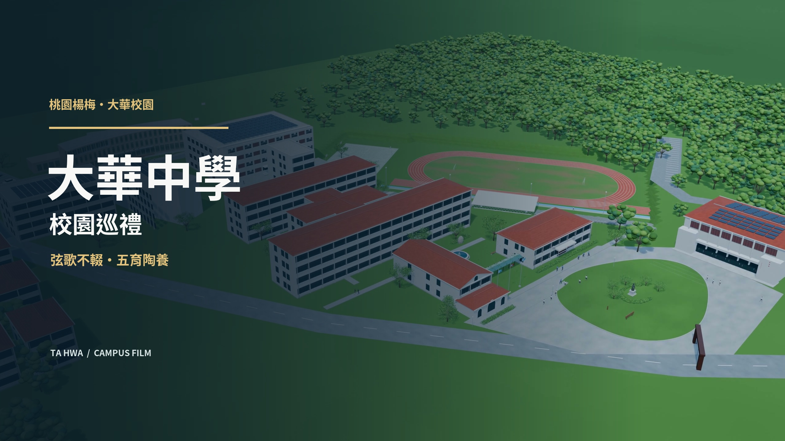

# v5：立面修補、粗體招牌與匿名學生步行

**已完成：94 秒／2560×1440／24 fps**。含大華中學片頭封面、使用者提供的原速校歌與 18 組分句繁體歌詞。

- [校歌字幕版影片](dahua-campus-94s-v5-school-song.mp4)
- [封面](music/大華中學_封面.jpg)
- [可編輯 Blender 模型](dahua-campus-v5.blend)
- [字幕 SRT](music/lyrics.srt)／[字幕 ASS](music/lyrics.ass)／[分句時間](music/lyrics-timing.json)
- [成片驗證](school-song-verification.json)



維持日景、1:34；提高至 2560×1440、24 fps，2256 個原生畫格，15 段鏡頭。Blender 5.4 Alpha / Eevee / 32 samples / AgX。

## 本次修正

- 重建原 1:12 定得樓的立面開口、樓板收邊、窗內填板、入口、窗柵、冷氣格柵與排水細節。
- 重建原 1:22 小學部弧形立面，使窗、柱、窗臺及收邊沿相同切線對齊；補齊厚樓板、內側牆與陽台。
- 依新校方照片補小學金屬雨遮、木平台、低扶手、玻璃門五金與招牌位置。
- 校舍文字改為 Noto CJK Bold 700，具厚度、倒角與固定結構的實體立體字；儲存為網格。
- 重新檢視目前 Maps 衛星圖與地面相片，補後側停車區、東側停車格、小學前橢圓花台與示意車輛。
- 補外牆窗框、密封條、屋簷、雨槽、屋頂接縫、排水溝與細微材質變化，修正前棟山牆與屋頂接合。
- 47 名可編輯骨架學生，包含中學白色紅藍線條體育服、淺藍正式服、深藍體育服，以及小學水手領、格紋裙、紅藍體育服。
- 兩段近距離服裝鏡頭，人物無細緻五官；交替支撐腳 IK、抬腳、擺臂及連續路線行走。

## 檔案

- `dahua-campus-v5.blend`：完整可編輯場景、人物骨架、材質和 94 秒相機動畫。
- `build_refined_scene.py`、`architecture_details.py`、`walking_students.py`：可重建來源。
- `render_video.py`：逐格輸出，分鏡頭保留可恢復串流及已完成片段，同一模型可續跑。
- `shots.json`、`camera-audit.json`、`architecture-repairs.json`、`gait-contact-audit.json`、`student-animation-manifest.json`：鏡頭、修補與角色資料。
- `SOURCES.md`、`reference/`、`reference-manifest.json`：來源與服裝判定限制。
- `previews/`：全部鏡頭起、中、終點及問題區間的實際渲染預覽。
- `dahua-campus-94s-v5.mp4`：無配樂的 3D 原始成片；`verification.json` 記錄其規格與解碼檢查。
- `dahua-campus-94s-v5-school-song.mp4`：含封面、配樂和燒錄歌詞的交付版；`school-song-verification.json` 記錄影像、音訊及同步檢查。
- `music/`、`finish_school_song.py`：原始 MP3、提供的歌詞、可編輯字幕與封面圖層、合成設定。
- `video-review/` 與 `music/lyrics-review.jpg`：從實際編碼成片擷取的檢查畫面。

## 再製

```sh
blender -b --python build_refined_scene.py
blender -b dahua-campus-v5.blend --python render_preflight.py
blender -b dahua-campus-v5.blend --python render_video.py
python3 verify_video.py
FFMPEG_CAPTION=/path/to/ffmpeg-with-libass python3 finish_school_song.py --render
python3 verify_school_song.py
```

需要 Blender 與 FFmpeg。`.render/` 保留完成的分鏡段；只有模型 SHA-256 和設定一致才接受續跑，片段的畫格數及時間刻度經核對後才合併。

## 真實性與驗證邊界

新立面與服裝依校方照片補強；Maps 改用同一 Chrome 新分頁後恢復，重新核對整體、後側小學與球場，並新增後側停車區、東側停車格及橢圓花台。淺藍正式服的確切年級歸屬未能由照片確認，部分尺寸與遮蔽結構仍有推估。見 SOURCES.md。

人物支撐腳有 27 次取樣，鞋底偏差在約 8 毫米內；此檢查不能證明全片每一步都沒有碰撞。全部鏡頭均有可見預覽，兩版成片均已通過完整解碼，皆為 2256 格、94 秒、1440p／24 fps。已抽查 15 段鏡頭中點、原問題時點前後及行走連續畫格；字幕版另抽查封面與全部 18 組歌詞。這些抽查不能證明每一格都沒有幾何問題。

## 校歌與歌詞

音樂由使用者提供，原檔 94.066938 秒；維持原速，以 94 秒為交付長度，僅裁末端約 67 毫秒，末尾淡出 0.35 秒。音量增加 2.5 dB，輸出 AAC 256 kbps／44.1 kHz／立體聲。封面疊在開場 0–6.5 秒，5.75 秒起淡出，因此不增加片長。

以本機 Whisper large-v3 交叉注意力 DTW 找演唱時間，文字逐句改回使用者提供的繁體版本，排除前奏和尾奏的辨識重複，18 組分句未遺漏任何提供的中文字。字幕以分句顯示，並非逐字卡拉 OK。未經人工聽審，不宣稱音素級精準；可直接編輯 `music/lyrics-timing.json` 或 SRT／ASS。三個演唱區間的原音與成片音訊互相關偏移皆為 0 秒；這證明配樂合成未移位，不能等同人工歌詞聽審。
